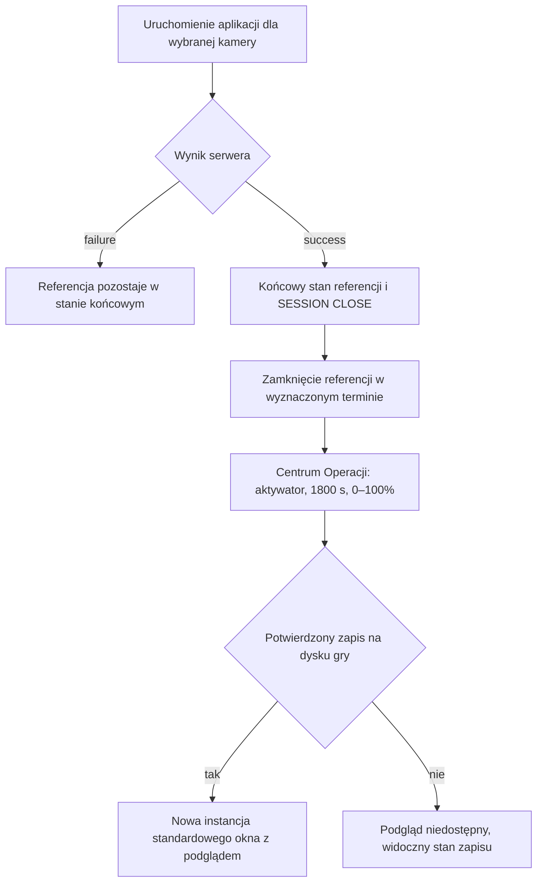

# Pilot kamery 164.0 — wspólna tablica pracy

Aktualizacja: 2026-10-31. Wersja tablicy: 6.

Korekta workflow: 165.1 pozostaje zakresem zmian w repo, do standardowego
commit/push po zgodzie. Zweryfikowano 99/99 plików dodatkowego ZIP i usunięto
zbędną dystrybucję. Testy i PASS zachowane; bez zmian implementacji/wzorca.
[Zakres Git](../audits/camera_street_view_165_1_git_scope.md).

**PROTOTYP ZAMKNIĘTY — PASS operatora** dla okna, ruchu i sześciu scenariuszy.
[Niezmienny snapshot](../prototypes/camera_view/accepted_164_0_2026_10_31/README.md):
28 plików z sumami SHA-256, kopie sprawdzone po zapisie. Backend w przebudowie
nie jest częścią tego PASS. Nie wracamy do projektowania wyglądu.

**Paczka 165.1 — implementacja lokalna zweryfikowana**, zgodnie z
[pełną wytyczną](camera_street_view_operator_contract_2026_10_31.md).
P21: LOCAL PASS — kanoniczne terminy i Super Powers, trwałe zużycie dostępu, nowa operacja po zamknięciu.
P22: LOCAL PASS — adapter/archiwum na fixtures, limity, optymalizacja, wycofania, admin i paczka.
[Raport i ograniczenia walidacji](../audits/camera_street_view_package_165_1.md).
Następny etap: osobna decyzja o wdrożeniu OFF, potem odbiór prawdziwego źródła w 166.
camera_off/camera_shutdown i incydenty pozostają nienaruszalne.
Starsze wpisy niżej opisują pilota; nowe reguły dostępu są nadrzędne.

**Cel:** jeden działający przypadek we właściwym gameplayu CHAOS: aplikacja
kamerowa → wynik operacji → aktywator → nowa instancja podglądu w Ghost Systemie.
Ta tablica to bieżące miejsce pracy nad pilotem. Aktualizujemy zadania, ustalenia
i dowody tutaj; sprinty opisują zakres, journal zachowuje historię pakietów.

**Teraz:** pełna ścieżka zaimplementowana i sprawdzona na właściwym lokalnym
pulpicie gry, na kopii konta `main`. **Operator zaakceptował wygląd i działanie show,
Focus/Teleport oraz elementy okna.** Dodano sześć assetów zakłóceń do tego pilota.
**Najbliższy krok:** odbiór paczki implementacyjnej 165.1; akceptacja wyglądu
nie jest już otwartą blokadą. Bez publikacji i VPS.
[Kod, wyniki testów, zrzuty i uruchomienie](../audits/camera_visual_gameplay_164_0.md).

## Nasz przypadek testowy

| Element | Ustalona wartość |
| --- | --- |
| Konto | `main` |
| Kamera | Kamera sklepu |
| Pozycja | `48.864173348628704, 2.330499567661377` |
| Pełne target_id | `map:48.864173348628704:2.330499567661377:Kamera sklepu` |
| Aplikacja startowa | Glass Eye, `admin_seed_camera_stream_v1` |
| Interfejs referencji | `progressbar_random` |
| Kontrakt | `map_actions: camera_stream`, `operation_types: camera_stream`, `target_types: camera` |
| Podgląd | Nowa instancja zwykłego okna Ghost Systemu, `interface: window` |
| Zakres kompatybilności | Mechanizm przez zgodny kontrakt aplikacji kamerowej, bez zależności od nazwy Glass Eye |
| Backup | `data/backups/game-prod-20261031T065150Z.sqlite3` |
| Lokalna kopia do pracy | `instance/cvn-gameplay-164/data/game.sqlite3` — właściwa gra przetestowana, zawiera ukończony przypadek |

Potwierdzenie celu w backupie: operacja `op_20261031061759_202628`, status
`cancelled`. Historyczny cel nie ma `camera_id`/`scan_id`; pilot rozpoznaje go
przez kanoniczny cel i historię operacji, z kontrolą pozycji/uprawnień serwera.
Aktualnie wycelowany cel zapisany w backupie to inna kamera.

Przekazany przez operatora request jest nowszy niż backup:

```json
{
  "app_id": "admin_seed_camera_stream_v1",
  "expected_target": {
    "target_id": "map:48.864173348628704:2.330499567661377:Kamera sklepu",
    "lat": 48.864173348628704,
    "lng": 2.330499567661377
  },
  "launch_key": "47b35865a4fb7612587a",
  "launch_receipt": "47b35865a4fb7612587a",
  "launch_source": "launch_queue",
  "request_ordinal": 1,
  "_flow_id": "hf-mvw3ould-ew687"
}
```

To zapis kontekstu diagnostycznego, nie polecenie ponownego wysłania requestu.
Współrzędne połączono z przekazanym celem; wiadomość operatora nie zawierała
pełnego payloadu. Receipt nie występuje w backupie.

## Uzgodniony przebieg



- Failure nie uruchamia pobierania ani podglądu i nie zamyka automatycznie referencji.
- SESSION CLOSE ma widoczne odliczanie; obecny standard to 5 sekund.
- Trwały stan przeżywa zamknięcie okien, odświeżenie i ponowne logowanie.
- Retry i równoległe karty nie tworzą kolejnych operacji, aktywatorów ani okien.
- Podgląd używa normalnego otwierania, belki, taskbara, drag/min/max/close.
- Jedno pobieranie 30 minut; nie dokładamy drugiego takiego etapu ani opłaty.
- Aktywator i materiał wizualny nie zastępują nagrody `camera_dump`.

## Tablica zadań

Statusy: **GOTOWE**, **DO ZROBIENIA**, **W TOKU**, **DO ODBIORU**, **BLOKADA**.
GOTOWE wymaga konkretnego wyniku lub dowodu. Odbiór wyglądu należy do operatora.

| ID | Zadanie | Status | Warunek zakończenia / wynik |
| --- | --- | --- | --- |
| P01 | Ustalić jeden realny przypadek | GOTOWE | Operator wskazał konto, kamerę i aplikację; potwierdzone w kanonicznych tabelach backupu |
| P02 | Przygotować lokalną bazę | GOTOWE | Osobna kopia w `instance/cvn-gameplay-164/data/`; źródłowy backup zachowany |
| P03 | Prześledzić start i wynik Glass Eye | GOTOWE | `/hack-action` → launch queue → referencja → `/gonna-win`; poprawione przekazywanie celu kolejki |
| P04 | Powiązać kamerę i zgodne aplikacje | GOTOWE | Cel legacy z kanonicznego store; kontrakt camera_stream, test innej wygenerowanej aplikacji PASS |
| P05 | Podłączyć trwały success/failure i SESSION CLOSE | GOTOWE | Trwałe wyniki; success zamyka referencję, failure pozostaje; test realnej gry PASS |
| P06 | Podłączyć aktywator do Centrum Operacji i dysku | GOTOWE | 1800 s, postęp, checksum/read-back; brak miejsca i korupcja blokują viewer; testy PASS |
| P07 | Otwierać zwykłe okno podglądu | GOTOWE | Standardowe window i taskbar, trzy obrazy, NO SIGNAL, reopen bez pobierania |
| P08 | Przygotować zamówione obrazy testowe Paryża | GOTOWE | Trzy wygenerowane kadry: zmierzch/noc/poranek; [pliki i pochodzenie](../../assets/camera_visual/pilot_164_0/paris/README.md). Fikcyjne otoczenie, nie zdjęcia faktycznej lokalizacji; podłączenie do UI pozostaje w P07 |
| P09 | Sprawdzić trwałość i deduplikację | GOTOWE | Backend i Playwright: retry, close/reopen, reload, re-login, dwie karty; jedna operacja i aktywator |
| P10 | Przetestować pełny gameplay lokalnie | GOTOWE | Rzeczywisty pulpit i trasy, success/failure, 15 sprawdzeń UI; zakres oraz ograniczenia zegara zapisane w audicie |
| P11 | Odebrać działanie i wygląd z operatorem | BAZA ZAAKCEPTOWANA | Operator zaakceptował pierwszy wygląd jako bazę; kolejny pakiet: ruchomy kadr i zakłócenia |
| P12 | Symulacja podglądu z trzech zdjęć | PASS LOKALNY / DO ODBIORU | Kadr 2×, patrol, zmiana co 24 s, przenikanie 2 s, szum/glitch, MapiFi i panel; 22 sprawdzenia Playwright PASS, 0 błędów konsoli |
| P13 | Nagłówek Camera Network i oznaczenia transmisji | PASS LOKALNY / DO ODBIORU | Przezroczyste turkusowe obramowania, wygenerowana ikona, link `lat:lon` do mapy, ONLINE/REC, czas Paryża i logi; 27 sprawdzeń UI + fokus mapy PASS |
| P14 | Stabilność przy blokadzie SQLite | PASS LOKALNY | Lease 60 s, odnowienie 20 s przed końcem, read-only heartbeat, pauza zamiast rekonstrukcji; wymuszony błąd i recovery: ten sam DOM, 0 ponownych pobrań |
| P15 | Wspólny standard linków CHAOS | PASS LOKALNY | Cztery warianty focus/teleport × lat:lon/cur:loc, badge’e panelu i informacji; [kontrakt v1](../architecture/chaos_links_v1.md) |
| P16 | Trwały ruch per gracz/podgląd | PASS LOKALNY | Losowane punkty i czas dla trzech zdjęć; zapis w grancie, ping-pong; osobny wariant drugiego gracza i trwałość potwierdzone testami |
| P17 | Ręczne skalowanie okna | PASS LOKALNY / DO ODBIORU | Natywny uchwyt resize Ghost Systemu, układ według szerokości okna, test przeciągania do 463×523 i zachowania ruchu |
| P18 | Jeden obraz i wolny zamknięty tor | ZAAKCEPTOWANE / PASS LOKALNY | Zastępuje rotację z P12/P16: jeden zapisany wybór, łuk Béziera, 180–300 s w jedną stronę, dokładny powrót; motion v2. 15 backend + 29 UI PASS, recovery bez ponownego pobrania |
| P19 | Systemowe akcje w tekstach i stopka MapiFi | ZAAKCEPTOWANE / PASS LOKALNY | Kamera: tylko Focus/Teleport z SVG na górze. Automatyczne focus:lat:lon / teleport:lat:lon w Cybernerze i Google Plexie; stała stopka źródła, autorstwa i licencji. Playwright PASS |

## Dowody i odbiór

| Sprawdzenie | Stan | Dowód |
| --- | --- | --- |
| Istnienie Glass Eye i kontraktu na `main` | Potwierdzone | Odczyt `player_apps` z backupu w trybie read-only, 31 X |
| Istnienie dokładnego celu | Potwierdzone | `player_operations`, operacja wskazana powyżej, 31 X |
| Lokalna kopia bazy | Uruchomiona | `PRAGMA quick_check`: ok; normalny Flask, login i `/desktop` |
| Rzeczywisty success → aktywator → nowe okno | PASS lokalny | [Audit gameplayu](../audits/camera_visual_gameplay_164_0.md); terminy tylko testowej operacji przesunięte, nie odczekano 30 min zegara ściennego |
| Rzeczywisty failure bez dalszego procesu | PASS lokalny | Wymagane aktywne zabezpieczenie; 0 nowych operacji, 0 viewerów, końcowa referencja |
| Trwałość, zapis i brak duplikatów | PASS lokalny | 10 testów backendu; UI reload/re-login/dwie karty; jeden aktywator w kopii |
| Wygląd standardowego okna | ZAAKCEPTOWANY | Operator zaakceptował obecny show, Focus/Teleport, ikonki i pozostałe elementy; pakiet zakłóceń P20 ma PASS lokalny |

Hosty A/B i ich screenshoty pozostają historią komponentów. Nie zaliczają
żadnego z powyższych testów gameplayu. Nie rozwijamy osobnego demonstratora.

## Otwarte ustalenia

| Temat | Kolejny krok | Kto |
| --- | --- | --- |
| Materiał dla kamery w Paryżu | Operator zamówił trzy syntetyczne kadry; gotowe w repo. Przy integracji pokazać oznaczenie AI i nie przedstawiać ich jako zweryfikowanej lokalizacji | Asystent |
| Cel legacy bez camera_id/scan_id | Rozwiązane dla pilota przez kanoniczny cel/historię i kontrolę dostępu serwera | Asystent |
| Wygląd i zachowanie | Odbiór zakończony; sześć dodatkowych assetów podpiętych i sprawdzonych w pilocie | Operator / Asystent |

Aktualizacja odbioru: operator zaakceptował wygląd i zachowanie pilota, w tym
P18 (jeden obraz i wolny tor) oraz P19 (akcje i stopka). Starsze statusy
„DO ODBIORU” powyżej opisują poprzedni etap i zostają zastąpione tą akceptacją.

### P20 — zestaw zakłóceń: PASS LOKALNY

**Porównanie dla operatora:** odśwież pulpit gry i w stopce okna kamery kliknij
**„Porównaj 6 zakłóceń”**. Sześć podpisanych kafli pokazuje osobno każdy scenariusz.
Kliknij ponownie, aby wrócić. Tracking/chroma/blocks w porównaniu powtarzają
się co 6/4/4 s; właściwy show zachowuje 49/67/83 s. Playwright: sześć kafli,
jedna instancja, poprawne zamknięcie, mobile i reduced-motion — PASS.
Zrzut: `artifacts/cvn-164-effects-comparison.png`.

- Sześć repozytoryjnych SVG: ziarno, linie, pas tracking, rozjazd koloru,
  bloki kompresji, utrata sygnału. [Zestaw i scenariusze](../../static/images/camera_visual/effects/README.md).
- Podpięte bezpośrednio do rzeczywistego okna. Brak nowych timerów, endpointów
  i wpływu na zapisany wybór zdjęcia, tor ruchu czy uprawnienia.
- Playwright: sześć plików pobranych i zdekodowanych, pięć warstw live,
  widoczność efektów, reduced-motion, pauza przy minimalizacji, ta sama instancja
  okna i obrazu. Awaria połączenia: asset dropout i powrót bez odtworzenia DOM
  lub ponownego pobierania zdjęcia. Zrzuty `artifacts/cvn-164-effects-*.png`.

## Zasady aktualizacji i granice

Po każdym spójnym pakiecie aktualizujemy status zadania, dowód i najbliższy krok.
Nowe decyzje wpisujemy tutaj, a zmiany zakresu także do sprintów. Krótką historię
pakietu zapisujemy w journalu. Nie oznaczamy zadania GOTOWE samym planem lub screenshotem.

LOCAL-FIRST; grupujemy implementację i testy. Bez pushu bez polecenia.
Backup i zmiany operatora pozostają zachowane. Wąskie kanoniczne store'y,
bez ciężkich profili, dawnych kolejek i odmrażania sprintów. Bez zdjęć graczy,
nowego systemu demonstracyjnego, aktywacji Mapillary i historycznych procedur VPS.

## Dokumenty powiązane

- [Sprint 164 — zakres pilota i dalszej infrastruktury](../sprints/sprint_164_camera_visual_archive.md)
- [Sprint 165 — rozszerzenie integracji i rollout](../sprints/sprint_165_camera_visual_network_rollout.md)
- [Historia demonstratorów A/B](../audits/camera_visual_prototype_164_0.md)
- [Kontrakt lekkich ścieżek profilu](../architecture/profile_hot_path_contract_130_11_plus.md)
- [Journal projektu](../history/project_journal.md)
