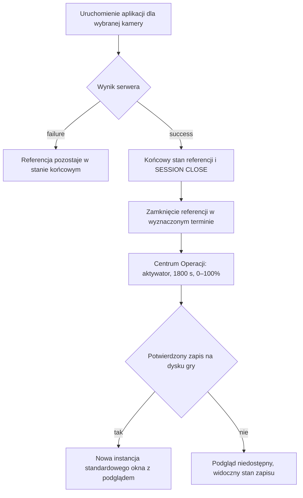

# Pilot kamery 164.0 — wspólna tablica pracy

Aktualizacja: 2026-11-01. Wersja tablicy: 12.

### Bieżący checkpoint 166.1

Nowe pobranie na VPS trwa (19:48:35–20:18:35 czasu wyświetlanego w UI),
poprawna nazwa „Kamera Le Monde de l'observation”. Lokalna poprawka kropki
scan_ports po sukcesie aplikacji oczekuje wdrożenia i odbioru wizualnego.

Do najbliższego wdrożenia: nazwy „Kamera <nazwa obiektu>” dla kamer przy
sklepach i bankomatach; aktualizacja przy świeżym skanie bez zmiany camera_id.

**Ponowny cykl — blokada w odbiorze:** po pierwszym PASS operator zgłosił
camera_scan_expired_or_unknown. Poprawiono lokalnie zachowanie świeżego
scan_id przy ponownym wyborze tej samej kamery. Nowe pobranie i otwarcie
na VPS nadal wymagają odbioru; wcześniejszy PASS dotyczy pierwszego cyklu.

**Domknięcie próby — PASS operatora:** po zamknięciu i odświeżeniu podgląd
op_20261101163829_682936 nie wraca. Próba nowej kamery na main zaliczona
od pobrania do jednorazowego otwarcia i zamknięcia. Inne konta oraz
Insider Feed pozostają do odbioru; poniżej wcześniejsze etapy tej próby.

**VPS PASS operatora: otwarcie nowej kamery po pełnym pobraniu (01.11).**
Operacja op_20261101163829_682936; materiał Mapillary z nowego archiwum,
lokalizacja 48.8577:2.3507, autor britze. Odczyt API i screenshot potwierdzają
działanie poprawki transportu. Następny odbiór: zamknięcie i odświeżenie tej
sesji bez ponownego otwarcia. Inne konta/Super Powers nadal niezaliczone.

Historia blokady i poprawki:

Po udanym skanie ujawniono brak sesji dla dwóch operacji nowej kamery.
Lokalna korekta transportu expected_target zachowuje camera_id/scan_id i typ
celu, które gubił frontend. Regresja serializacji desktop/kolejka PASS.
Do odbioru po wdrożeniu: nowy sukces tworzy sesję i camera_visual w operacji,
a po normalnym pobraniu otwiera się jedno okno. Bez grantów wstecz.

Blokada skanu MapLark wyjaśniona: truncated przy porcji 1000. Korekta operatora:
przyjmujemy poprawne obserwacje do świata i gameplayu z jawnym partial, bez
certyfikowania kompletnego obszaru. Poprawka lokalna + 52 testy POI/i18n oraz
Playwright PL/EN PASS, oczekuje na standardowy deploy; budżety/global OFF bez zmian.

Branding Mapillary i EXTERNAL CONNECTION: LOCAL PASS, 21 kontroli Playwright,
spóźniony materiał bez odtwarzania okna PASS. Utrzymany grant przy wyjściu do
nowej karty. Przy global OFF autoryzowany pilot może użyć nowej kamery ze skanu.
Kandydat z backupu: camera_0014ac41c138c389e40fa5cf / rodzic 5001825490 /
48.85294369549624:2.3349836995089666. Wymaga świeżego potwierdzenia na VPS.
Nowe pozyskanie, WebP/checksum i realny download: OCZEKUJE NA ODBIÓR VPS.
L02 OPEN, global OFF; bez rozszerzania do 166.2–166.5.
[Zbiorczy raport](../audits/camera_street_view_checkpoint_166_1.md).

### Bieżący odbiór VPS 56d5af0

| Próba | Stan / granica dowodu |
| --- | --- |
| Trzy procesy, wspólna DB/config, heartbeat, HTTP, PM2 save | PASS według wyników operatora |
| Token w procesie archive i zapisanym PM2; metadata API | PASS; nie jest dowodem nowego pobrania zdjęć |
| Materiał testowej kamery | READY, 2 zdjęcia, checksum OK |
| Niepoprawna odpowiedź / UI failed → 30 min download → brak podglądu | PASS obserwacji operatora; współistnienie failed i operacji WYJAŚNIONE — nie regresja. Status etapu UI nie jest kanonicznym wynikiem backendu |
| Kolejna próba tej samej kamery: success → nowy download 30 min → podgląd | PASS operatora ze screenshotem: okno Camera Network, obraz Mapillary, ONLINE/REC i atrybucja |

Drugi przebieg zakończony PASS otwarcia. Nie utożsamiać
błędu odpowiedzi HTTP z potwierdzonym failure zapisanym w backendzie bez
korelacji receipt/operation_id. Nie resetować poprzedniego grantu.

Rezerwacja należy do ciągłości mapy → OFC → pickera → desktopu; nie usuwać jej
automatycznie po niepowodzeniu etapu aplikacji. Sama rezerwacja nie uprawnia do
podglądu: wymagane są sukces backendu, upływ kanonicznego czasu, dopuszczony
stan operacji i zweryfikowany aktywator; zamknięty grant pozostaje consumed.
Przekazane cztery rekordy mają server_success=true, timeout i aktywator;
trzy są zamknięte, najnowszy op_20261101100159_497862 pozostaje otwarty.
Nie są dowodem kanonicznego failure ani dokładnej przyczyny komunikatu UI.
Kontrola warunków w kodzie i istniejące zaliczone testy: patrz wpis wyjaśnienia
z 01.11.2026 w [journalu](../history/project_journal.md).

System S1–S3 i wspólne CHAOS Links: kod zintegrowany lokalnie, testy i granice
w [raporcie implementacji](../audits/camera_street_view_system_implementation_2026_11_01.md).
Zamrożony wzorzec: 28 SHA256 PASS. Pilot nie jest rozwijany jako osobny produkt.
Właściwy następny krok: odbiór 166 według zbiorczego runbooka po decyzji wdrożenia.

**PILOT ZAMKNIĘTY — PASS operatora.** Bieżący kierunek to pełna integracja
systemowa, nie dalsza rozbudowa pilota. [Audyt zakresu i luk](../audits/camera_street_view_system_audit_2026_11_01.md).

| Zadanie po pilocie | Stan |
| --- | --- |
| A01 audyt kodu/dowodów + korekta sprintów 164–166 | DONE 01.11, bez zmian runtime i powtarzania testów |
| S1 kontrakt wspólnego losowania foto/motion/FX/offline + wszystkie kamery | PLAN, sprint 164.S |
| S2 renderer/lifecycle/systemowe aplikacje i gracze | PLAN, sprint 165.S |
| S3 automatyczne archiwum, konfiguracja procesów, skala/utrzymanie/admin | CZĘŚCIOWE podstawy, domknięcie 164.S/165.S |
| S4 zbiorcza macierz wielu kont/kamer/mocy/czasów | PO S1–S3, sprint 166.S; insider_feed/robot tutaj |
| S5 globalne wdrożenie i odbiór | PO raporcie gotowości, sprint 166.R |

S1–S3 tworzą jeden zakres implementacyjny LOCAL-FIRST. Nie otwierać ponownie
odbioru zaakceptowanego wyglądu; zachować snapshot. Punkty poniżej są dowodami
i historią pilota, nie bieżącym planem nowych mikrotestów.

**Odbiór VPS 166 w toku:** Mapillary metadata/archiwum PASS, dwie rzeczywiste
miniatury WebP; po pełnym 30-minutowym download i korekcie konfiguracji
istniejącego territory workera otwarto podgląd na tej samej operacji.
Zrzut operatora potwierdza obraz/atrybucję w natywnym oknie. Po zamknięciu API
potwierdza consumed/viewer_closed=true — zapis zużycia PASS. Operator potwierdził,
że zamknięty podgląd nie wraca. Kolejne hakowanie, zwykły download 30 min
i automatyczne otwarcie nowej instancji: PASS operatora.
Resize/restore pozostaje do potwierdzenia. Test mocy insider_feed (np. robot)
zgodnie z decyzją operatora przechodzi do szerszego pilota; live PASS jeszcze brak.
Nie jest to pełny PASS 166.

Korekta workflow: 165.1 pozostaje zakresem zmian w repo, do standardowego
commit/push po zgodzie. Zweryfikowano 99/99 plików dodatkowego ZIP i usunięto
zbędną dystrybucję. Testy i PASS zachowane; bez zmian implementacji/wzorca.
[Zakres Git](../audits/camera_street_view_165_1_git_scope.md).

**PROTOTYP ZAMKNIĘTY — PASS operatora** dla okna, ruchu i sześciu scenariuszy.
[Niezmienny snapshot](../prototypes/camera_view/accepted_164_0_2026_10_31/README.md):
28 plików z sumami SHA-256, kopie sprawdzone po zapisie. Backend w przebudowie
nie jest częścią tego PASS. Nie wracamy do projektowania wyglądu.

**Paczka 165.1 — implementacja lokalna zweryfikowana**, zgodnie z
[pełną wytyczną](camera_street_view_operator_contract_2026_10_31.md).
P21: LOCAL PASS — kanoniczne terminy i Super Powers, trwałe zużycie dostępu, nowa operacja po zamknięciu.
P22: LOCAL PASS — adapter/archiwum na fixtures, limity, optymalizacja, wycofania, admin i paczka.
[Raport i ograniczenia walidacji](../audits/camera_street_view_package_165_1.md).
Następny etap: osobna decyzja o wdrożeniu OFF, potem odbiór prawdziwego źródła w 166.
camera_off/camera_shutdown i incydenty pozostają nienaruszalne.
Starsze wpisy niżej opisują pilota; nowe reguły dostępu są nadrzędne.

**Cel:** jeden działający przypadek we właściwym gameplayu CHAOS: aplikacja
kamerowa → wynik operacji → aktywator → nowa instancja podglądu w Ghost Systemie.
Ta tablica to bieżące miejsce pracy nad pilotem. Aktualizujemy zadania, ustalenia
i dowody tutaj; sprinty opisują zakres, journal zachowuje historię pakietów.

**Teraz:** pełna ścieżka zaimplementowana i sprawdzona na właściwym lokalnym
pulpicie gry, na kopii konta `main`. **Operator zaakceptował wygląd i działanie show,
Focus/Teleport oraz elementy okna.** Dodano sześć assetów zakłóceń do tego pilota.
**Najbliższy krok:** odbiór paczki implementacyjnej 165.1; akceptacja wyglądu
nie jest już otwartą blokadą. Bez publikacji i VPS.
[Kod, wyniki testów, zrzuty i uruchomienie](../audits/camera_visual_gameplay_164_0.md).

## Nasz przypadek testowy

| Element | Ustalona wartość |
| --- | --- |
| Konto | `main` |
| Kamera | Kamera sklepu |
| Pozycja | `48.864173348628704, 2.330499567661377` |
| Pełne target_id | `map:48.864173348628704:2.330499567661377:Kamera sklepu` |
| Aplikacja startowa | Glass Eye, `admin_seed_camera_stream_v1` |
| Interfejs referencji | `progressbar_random` |
| Kontrakt | `map_actions: camera_stream`, `operation_types: camera_stream`, `target_types: camera` |
| Podgląd | Nowa instancja zwykłego okna Ghost Systemu, `interface: window` |
| Zakres kompatybilności | Mechanizm przez zgodny kontrakt aplikacji kamerowej, bez zależności od nazwy Glass Eye |
| Backup | `data/backups/game-prod-20261031T065150Z.sqlite3` |
| Lokalna kopia do pracy | `instance/cvn-gameplay-164/data/game.sqlite3` — właściwa gra przetestowana, zawiera ukończony przypadek |

Potwierdzenie celu w backupie: operacja `op_20261031061759_202628`, status
`cancelled`. Historyczny cel nie ma `camera_id`/`scan_id`; pilot rozpoznaje go
przez kanoniczny cel i historię operacji, z kontrolą pozycji/uprawnień serwera.
Aktualnie wycelowany cel zapisany w backupie to inna kamera.

Przekazany przez operatora request jest nowszy niż backup:

```json
{
  "app_id": "admin_seed_camera_stream_v1",
  "expected_target": {
    "target_id": "map:48.864173348628704:2.330499567661377:Kamera sklepu",
    "lat": 48.864173348628704,
    "lng": 2.330499567661377
  },
  "launch_key": "47b35865a4fb7612587a",
  "launch_receipt": "47b35865a4fb7612587a",
  "launch_source": "launch_queue",
  "request_ordinal": 1,
  "_flow_id": "hf-mvw3ould-ew687"
}
```

To zapis kontekstu diagnostycznego, nie polecenie ponownego wysłania requestu.
Współrzędne połączono z przekazanym celem; wiadomość operatora nie zawierała
pełnego payloadu. Receipt nie występuje w backupie.

## Uzgodniony przebieg



- Failure nie uruchamia pobierania ani podglądu i nie zamyka automatycznie referencji.
- SESSION CLOSE ma widoczne odliczanie; obecny standard to 5 sekund.
- Trwały stan przeżywa zamknięcie okien, odświeżenie i ponowne logowanie.
- Retry i równoległe karty nie tworzą kolejnych operacji, aktywatorów ani okien.
- Podgląd używa normalnego otwierania, belki, taskbara, drag/min/max/close.
- Jedno pobieranie 30 minut; nie dokładamy drugiego takiego etapu ani opłaty.
- Aktywator i materiał wizualny nie zastępują nagrody `camera_dump`.

## Tablica zadań

Statusy: **GOTOWE**, **DO ZROBIENIA**, **W TOKU**, **DO ODBIORU**, **BLOKADA**.
GOTOWE wymaga konkretnego wyniku lub dowodu. Odbiór wyglądu należy do operatora.

| ID | Zadanie | Status | Warunek zakończenia / wynik |
| --- | --- | --- | --- |
| P01 | Ustalić jeden realny przypadek | GOTOWE | Operator wskazał konto, kamerę i aplikację; potwierdzone w kanonicznych tabelach backupu |
| P02 | Przygotować lokalną bazę | GOTOWE | Osobna kopia w `instance/cvn-gameplay-164/data/`; źródłowy backup zachowany |
| P03 | Prześledzić start i wynik Glass Eye | GOTOWE | `/hack-action` → launch queue → referencja → `/gonna-win`; poprawione przekazywanie celu kolejki |
| P04 | Powiązać kamerę i zgodne aplikacje | GOTOWE | Cel legacy z kanonicznego store; kontrakt camera_stream, test innej wygenerowanej aplikacji PASS |
| P05 | Podłączyć trwały success/failure i SESSION CLOSE | GOTOWE | Trwałe wyniki; success zamyka referencję, failure pozostaje; test realnej gry PASS |
| P06 | Podłączyć aktywator do Centrum Operacji i dysku | GOTOWE | 1800 s, postęp, checksum/read-back; brak miejsca i korupcja blokują viewer; testy PASS |
| P07 | Otwierać zwykłe okno podglądu | GOTOWE | Standardowe window i taskbar, trzy obrazy, NO SIGNAL, reopen bez pobierania |
| P08 | Przygotować zamówione obrazy testowe Paryża | GOTOWE | Trzy wygenerowane kadry: zmierzch/noc/poranek; [pliki i pochodzenie](../../assets/camera_visual/pilot_164_0/paris/README.md). Fikcyjne otoczenie, nie zdjęcia faktycznej lokalizacji; podłączenie do UI pozostaje w P07 |
| P09 | Sprawdzić trwałość i deduplikację | GOTOWE | Backend i Playwright: retry, close/reopen, reload, re-login, dwie karty; jedna operacja i aktywator |
| P10 | Przetestować pełny gameplay lokalnie | GOTOWE | Rzeczywisty pulpit i trasy, success/failure, 15 sprawdzeń UI; zakres oraz ograniczenia zegara zapisane w audicie |
| P11 | Odebrać działanie i wygląd z operatorem | BAZA ZAAKCEPTOWANA | Operator zaakceptował pierwszy wygląd jako bazę; kolejny pakiet: ruchomy kadr i zakłócenia |
| P12 | Symulacja podglądu z trzech zdjęć | PASS LOKALNY / DO ODBIORU | Kadr 2×, patrol, zmiana co 24 s, przenikanie 2 s, szum/glitch, MapiFi i panel; 22 sprawdzenia Playwright PASS, 0 błędów konsoli |
| P13 | Nagłówek Camera Network i oznaczenia transmisji | PASS LOKALNY / DO ODBIORU | Przezroczyste turkusowe obramowania, wygenerowana ikona, link `lat:lon` do mapy, ONLINE/REC, czas Paryża i logi; 27 sprawdzeń UI + fokus mapy PASS |
| P14 | Stabilność przy blokadzie SQLite | PASS LOKALNY | Lease 60 s, odnowienie 20 s przed końcem, read-only heartbeat, pauza zamiast rekonstrukcji; wymuszony błąd i recovery: ten sam DOM, 0 ponownych pobrań |
| P15 | Wspólny standard linków CHAOS | PASS LOKALNY | Cztery warianty focus/teleport × lat:lon/cur:loc, badge’e panelu i informacji; [kontrakt v1](../architecture/chaos_links_v1.md) |
| P16 | Trwały ruch per gracz/podgląd | PASS LOKALNY | Losowane punkty i czas dla trzech zdjęć; zapis w grancie, ping-pong; osobny wariant drugiego gracza i trwałość potwierdzone testami |
| P17 | Ręczne skalowanie okna | PASS LOKALNY / DO ODBIORU | Natywny uchwyt resize Ghost Systemu, układ według szerokości okna, test przeciągania do 463×523 i zachowania ruchu |
| P18 | Jeden obraz i wolny zamknięty tor | ZAAKCEPTOWANE / PASS LOKALNY | Zastępuje rotację z P12/P16: jeden zapisany wybór, łuk Béziera, 180–300 s w jedną stronę, dokładny powrót; motion v2. 15 backend + 29 UI PASS, recovery bez ponownego pobrania |
| P19 | Systemowe akcje w tekstach i stopka MapiFi | ZAAKCEPTOWANE / PASS LOKALNY | Kamera: tylko Focus/Teleport z SVG na górze. Automatyczne focus:lat:lon / teleport:lat:lon w Cybernerze i Google Plexie; stała stopka źródła, autorstwa i licencji. Playwright PASS |

## Dowody i odbiór

| Sprawdzenie | Stan | Dowód |
| --- | --- | --- |
| Istnienie Glass Eye i kontraktu na `main` | Potwierdzone | Odczyt `player_apps` z backupu w trybie read-only, 31 X |
| Istnienie dokładnego celu | Potwierdzone | `player_operations`, operacja wskazana powyżej, 31 X |
| Lokalna kopia bazy | Uruchomiona | `PRAGMA quick_check`: ok; normalny Flask, login i `/desktop` |
| Rzeczywisty success → aktywator → nowe okno | PASS lokalny | [Audit gameplayu](../audits/camera_visual_gameplay_164_0.md); terminy tylko testowej operacji przesunięte, nie odczekano 30 min zegara ściennego |
| Rzeczywisty failure bez dalszego procesu | PASS lokalny | Wymagane aktywne zabezpieczenie; 0 nowych operacji, 0 viewerów, końcowa referencja |
| Trwałość, zapis i brak duplikatów | PASS lokalny | 10 testów backendu; UI reload/re-login/dwie karty; jeden aktywator w kopii |
| Wygląd standardowego okna | ZAAKCEPTOWANY | Operator zaakceptował obecny show, Focus/Teleport, ikonki i pozostałe elementy; pakiet zakłóceń P20 ma PASS lokalny |

Hosty A/B i ich screenshoty pozostają historią komponentów. Nie zaliczają
żadnego z powyższych testów gameplayu. Nie rozwijamy osobnego demonstratora.

## Otwarte ustalenia

| Temat | Kolejny krok | Kto |
| --- | --- | --- |
| Materiał dla kamery w Paryżu | Operator zamówił trzy syntetyczne kadry; gotowe w repo. Przy integracji pokazać oznaczenie AI i nie przedstawiać ich jako zweryfikowanej lokalizacji | Asystent |
| Cel legacy bez camera_id/scan_id | Rozwiązane dla pilota przez kanoniczny cel/historię i kontrolę dostępu serwera | Asystent |
| Wygląd i zachowanie | Odbiór zakończony; sześć dodatkowych assetów podpiętych i sprawdzonych w pilocie | Operator / Asystent |

Aktualizacja odbioru: operator zaakceptował wygląd i zachowanie pilota, w tym
P18 (jeden obraz i wolny tor) oraz P19 (akcje i stopka). Starsze statusy
„DO ODBIORU” powyżej opisują poprzedni etap i zostają zastąpione tą akceptacją.

### P20 — zestaw zakłóceń: PASS LOKALNY

**Porównanie dla operatora:** odśwież pulpit gry i w stopce okna kamery kliknij
**„Porównaj 6 zakłóceń”**. Sześć podpisanych kafli pokazuje osobno każdy scenariusz.
Kliknij ponownie, aby wrócić. Tracking/chroma/blocks w porównaniu powtarzają
się co 6/4/4 s; właściwy show zachowuje 49/67/83 s. Playwright: sześć kafli,
jedna instancja, poprawne zamknięcie, mobile i reduced-motion — PASS.
Zrzut: `artifacts/cvn-164-effects-comparison.png`.

- Sześć repozytoryjnych SVG: ziarno, linie, pas tracking, rozjazd koloru,
  bloki kompresji, utrata sygnału. [Zestaw i scenariusze](../../static/images/camera_visual/effects/README.md).
- Podpięte bezpośrednio do rzeczywistego okna. Brak nowych timerów, endpointów
  i wpływu na zapisany wybór zdjęcia, tor ruchu czy uprawnienia.
- Playwright: sześć plików pobranych i zdekodowanych, pięć warstw live,
  widoczność efektów, reduced-motion, pauza przy minimalizacji, ta sama instancja
  okna i obrazu. Awaria połączenia: asset dropout i powrót bez odtworzenia DOM
  lub ponownego pobierania zdjęcia. Zrzuty `artifacts/cvn-164-effects-*.png`.

## Zasady aktualizacji i granice

Po każdym spójnym pakiecie aktualizujemy status zadania, dowód i najbliższy krok.
Nowe decyzje wpisujemy tutaj, a zmiany zakresu także do sprintów. Krótką historię
pakietu zapisujemy w journalu. Nie oznaczamy zadania GOTOWE samym planem lub screenshotem.

LOCAL-FIRST; grupujemy implementację i testy. Bez pushu bez polecenia.
Backup i zmiany operatora pozostają zachowane. Wąskie kanoniczne store'y,
bez ciężkich profili, dawnych kolejek i odmrażania sprintów. Bez zdjęć graczy,
nowego systemu demonstracyjnego, aktywacji Mapillary i historycznych procedur VPS.

## Dokumenty powiązane

- [Sprint 164 — zakres pilota i dalszej infrastruktury](../sprints/sprint_164_camera_visual_archive.md)
- [Sprint 165 — rozszerzenie integracji i rollout](../sprints/sprint_165_camera_visual_network_rollout.md)
- [Historia demonstratorów A/B](../audits/camera_visual_prototype_164_0.md)
- [Kontrakt lekkich ścieżek profilu](../architecture/profile_hot_path_contract_130_11_plus.md)
- [Journal projektu](../history/project_journal.md)
